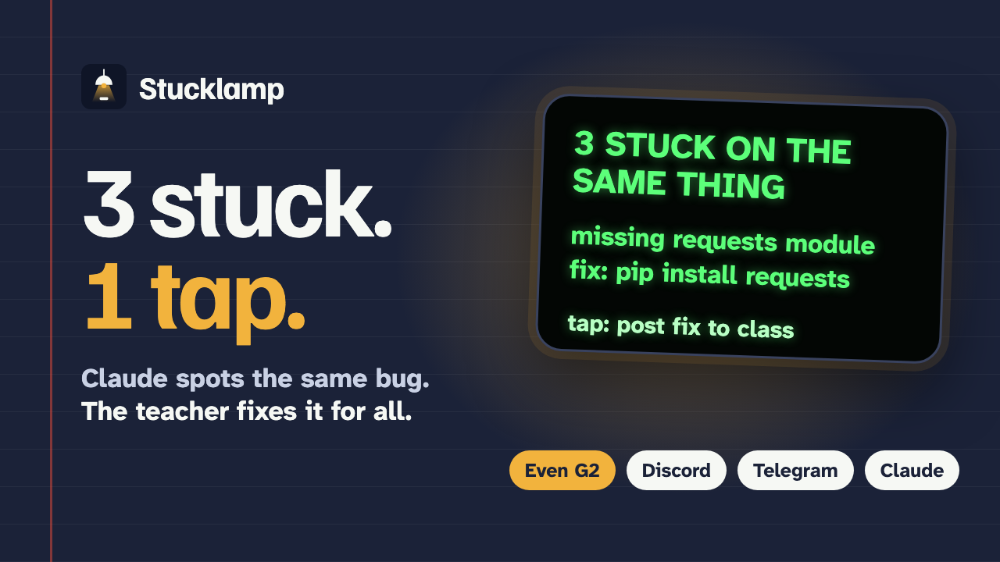
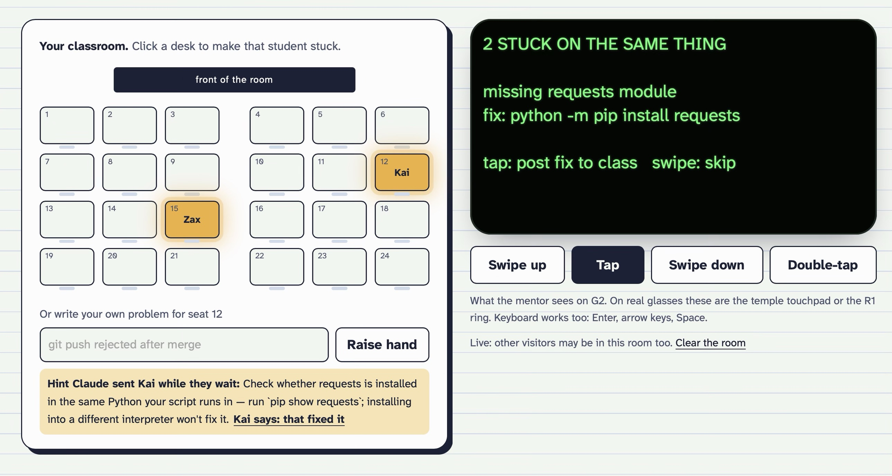
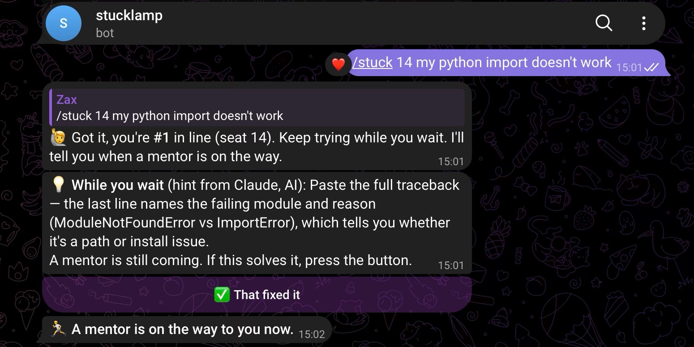
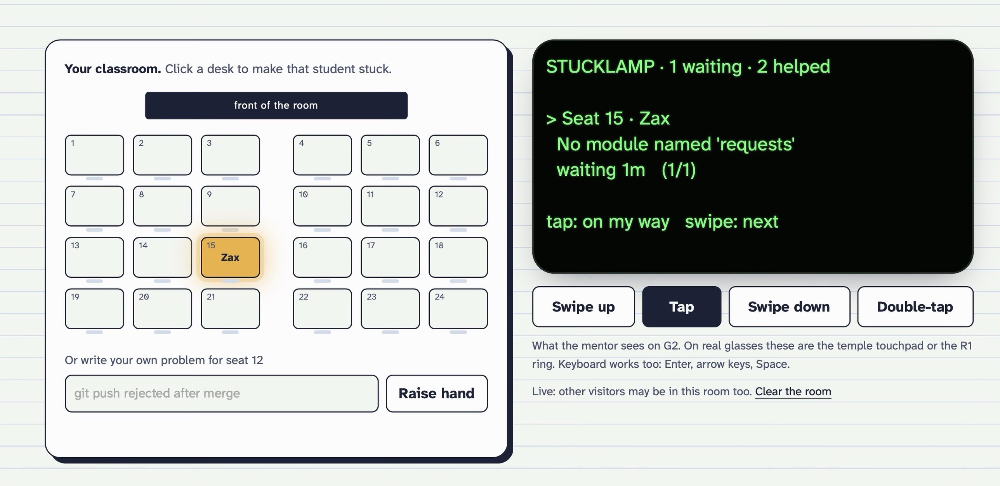
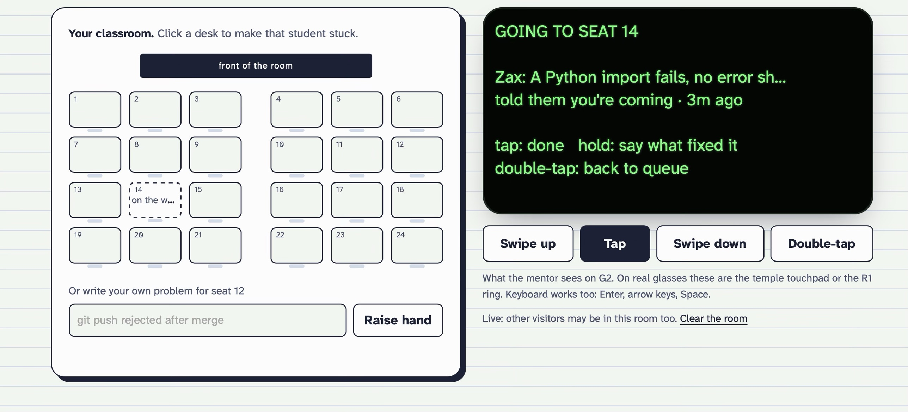
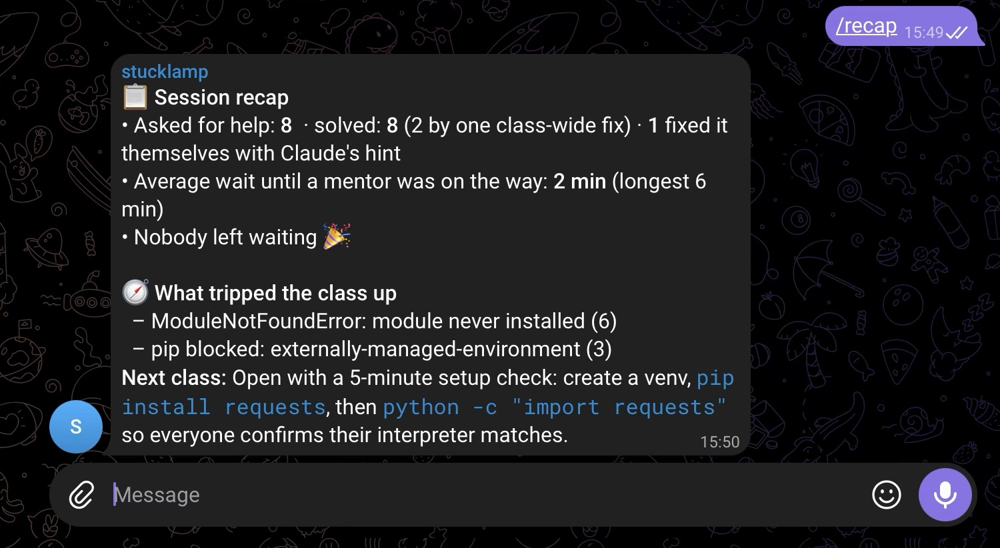

<p align="center">
  
</p>

<h1 align="center">Stucklamp</h1>

<h3 align="center">In a class of thirty, the students who need help most are the ones who never raise a hand.<br>Stucklamp lets them type <code>/stuck</code> in Discord or Telegram, and the teacher sees who to help next<br>on Even Realities G2 glasses, while walking the room and still looking at the students.</h3>

<p align="center">
  <a href="https://youtu.be/COrmAcOw3nk"></a>
  <a href="https://3-80-82-140.sslip.io"></a>
  <a href="https://t.me/stucklamp_bot"></a>
  <a href="https://discord.com/oauth2/authorize?client_id=1575106449074561116"></a>
  <a href="#-see-it-in-5-minutes"></a>
  <a href="#-proof"></a>
</p>

<p align="center">
  <a href="https://youtu.be/COrmAcOw3nk"></a>
</p>

<p align="center">
  
  
  
  <a href="#-proof"></a>
  <a href="#-privacy-and-safety"></a>
  <a href="#-privacy-and-safety"></a>
  <a href="LICENSE"></a>
</p>

<p align="center">
  <a href="#-try-it-now">Try it</a> ·
  <a href="#-in-30-seconds">In 30 seconds</a> ·
  <a href="#-see-it-in-5-minutes">See it</a> ·
  <a href="#-the-problem">The problem</a> ·
  <a href="#-how-it-works">How it works</a> ·
  <a href="#-what-claude-does">Claude</a> ·
  <a href="#-proof">Proof</a> ·
  <a href="#-privacy-and-safety">Privacy</a> ·
  <a href="#-roadmap">Roadmap</a> ·
  <a href="#-run-it-yourself">Run it</a>
</p>

<p align="center">
  
  <br><sub>Two students, one on Telegram and one on the web, hit the same error. Claude noticed. One tap on the glasses sends the fix to both.</sub>
</p>

## 🔗 Try it now

| | What | Link |
|:---:|---|---|
| ▶ | **Try it in your browser:** be the students on the left, the teacher wearing G2 on the right | **[3-80-82-140.sslip.io](https://3-80-82-140.sslip.io)** |
| 💬 | **Telegram bot:** press Start, add it to a group, send `/stuck 14 what is wrong` | **[t.me/stucklamp_bot](https://t.me/stucklamp_bot)** |
| 🎮 | **Discord bot:** add it to your server, then type `/stuck` in any channel | **[Add Stucklamp to Discord](https://discord.com/oauth2/authorize?client_id=1575106449074561116)** |
| 👓 | **The teacher's live view** for the Telegram and Discord bots (open it next to Telegram and watch your `/stuck` appear) | **[3-80-82-140.sslip.io/?room=demo](https://3-80-82-140.sslip.io/?room=demo)** |
| 📦 | **The G2 app** (`stucklamp.ehpk`), to install on real glasses | **[Releases](../../releases)** |

---

## ⏱ In 30 seconds

| 🙋 **The student** | 👓 **The teacher** | 🤖 **Claude** |
|:---|:---|:---|
| Types `/stuck 14 pip install fails` in the class Discord or Telegram. No app to install, no hand in the air. | Sees **one line** on the G2 glasses: *"Seat 14 · pip install blocked · waiting 3m"*. Taps once: the student gets *"🏃 A mentor is on the way."* | Sends the student a **hint** while they wait, notices when **five people have the same problem**, and writes **one fix** the teacher can send to all five with one tap. |

<table>
  <tr>
    <td align="center" width="25%"><h3>1 tap</h3><sub>from "who's next?"<br>to "I'm on my way"</sub></td>
    <td align="center" width="25%"><h3>2.4 min</h3><sub>average wait in our first<br>real class test</sub></td>
    <td align="center" width="25%"><h3>1.00</h3><sub>grouping precision:<br>0 wrong groups in 60 pairs</sub></td>
    <td align="center" width="25%"><h3>3</h3><sub>ways in: Discord,<br>Telegram, a web form</sub></td>
  </tr>
</table>
<p align="center"><sub>Measured Nov 25–26, 2026. Details and honest limits in <a href="#-proof">Proof</a>.</sub></p>

## 📸 See it in 5 minutes

**▶ Try it yourself first (2 minutes, nothing to install):** open **[3-80-82-140.sslip.io](https://3-80-82-140.sslip.io)**. Click a few desks on the left to make students stuck. Then use **Tap / Swipe** on the right, exactly as a teacher would on the glasses.

**1 · The student asks.** In Telegram ([@stucklamp_bot](https://t.me/stucklamp_bot)) or Discord ([add the bot](https://discord.com/oauth2/authorize?client_id=1575106449074561116)) they type `/stuck`, the seat and what's wrong. They get their place in line right away, then a hint from Claude, then *"a mentor is on the way"* the moment the teacher taps.

<p align="center"></p>

**2 · The teacher sees who's next.** The glasses show one student at a time, longest wait first. **Tap** = "on my way". **Swipe** = next student.

<p align="center"></p>

**3 · Walking over.** The glasses switch to *"Going to seat 14"*. **Tap** when it's fixed. Or **hold** and say what fixed it (*"he needed to pull before pushing"*); the note is saved for the recap.

<p align="center"></p>

**4 · Same problem, one fix.** When several students are stuck on the same thing, Claude groups them and writes a fix. One tap posts it to every one of them. (See the big picture at the top.)

**5 · The recap.** At the end the teacher types `/recap`: how many asked, how many were solved and how, the average wait, and **what tripped the class up, with one thing to do differently next time.**

<p align="center"></p>
<p align="center"><sub>A recap from Nov 26. Its totals cover the whole day in that room, including our own test runs, so the real-user numbers are in <a href="#-proof">Proof</a>.</sub></p>

## 😩 The problem

You're teaching a coding class, a university lab or a hackathon help desk. Thirty people on laptops, and some of them are stuck.

- ✋ **Hands go up, and you can't tell who has waited longest.**
- 🙈 **Shy students never raise a hand.** They quietly fall behind.
- 🔁 **Five people hit the same `pip install` error,** and you explain it five times.
- 📱 **A help queue on a laptop or phone** means looking down at a screen instead of at your students.

Research says this matters. In Carnegie Mellon's **Lumilo** studies, teachers wearing mixed-reality glasses that showed which students were stuck spent their time on the students who needed it most, and **students learned more** (Holstein, McLaren & Aleven, AIED 2018). But that prototype ran on a HoloLens, far too heavy to wear all day. **The G2 looks and wears like normal glasses.** Stucklamp brings that idea to a normal classroom, through the chat app the class already has open.

**Who it's for:** teachers of hands-on classes (coding, labs, design) with 10–40 students · university teaching assistants · bootcamp and hackathon mentors.

## 💡 How it works

```
 STUDENT (Discord / Telegram)              TEACHER (G2 glasses)
 ────────────────────────────              ────────────────────
 /stuck 14 pip install fails      ──▶      STUCKLAMP · 3 waiting · 4 helped
                                           > Seat 14 · Maya
 🙋 "You're #3 in line"                       pip install: externally-managed
 💡 hint from Claude                          waiting 6m   (1/3)
    [✅ That fixed it]                      tap: on my way   swipe: next
                                  ◀── tap
 🏃 "A mentor is on the way"                GOING TO SEAT 14
                                           tap: done   hold: say what fixed it
```

**When several students have the same problem:**

```
                                           2 STUCK ON THE SAME THING
                                           pip install blocked (PEP 668)
                                           fix: use a venv, then pip install flask
                                  ◀── tap  tap: post fix to class   swipe: skip
 💡 @Maya @Omar: 2 of you hit the same problem.
    Make a virtualenv (python -m venv .venv), activate it,
    pip install flask inside it, then rerun python app.py.
```

### 👓 On the glasses

| Screen | Tap | Swipe | Double-tap |
|---|---|---|---|
| **Next student** (longest wait first) | "on my way": the student is told. If another mentor got there first, you're told instead. | next student | – |
| **Going to a student** | done (or **hold** and say what fixed it, saved as a note) | – | back to the queue |
| **N stuck on the same thing** | post one fix to all of them | skip | – |
| **Nobody stuck** | – | – | exit |

### 💬 In Discord and Telegram

| Command | Who | What happens |
|---|---|---|
| `/stuck` + seat + problem | student | Joins the line. One open request per student, and the seat is remembered. Discord: `/stuck problem: … seat: …` · Telegram: `/stuck 14 …` |
| `/unstuck` | student | "I fixed it myself", leaves the line |
| `/recap` | teacher | Session summary: asked, solved (by a mentor, by a class-wide fix, or alone with a hint), average and longest wait, who's still waiting, and what tripped the class up |

No chat app? Students can also use the **web form** on the try-it page.

## 🤖 What Claude does

| | What | Example |
|---|---|---|
| ✂️ | **Shortens** each request to ≤ 38 characters so it fits the 576×288 glasses display, keeping the error name. | *"hi sorry my code doesnt run, it says ModuleNotFoundError: No module named flask…"* → **"ModuleNotFoundError: flask missing"** |
| 💡 | **Hints** while the student waits: one nudge, not the full answer, so they still learn. If it works they press **That fixed it** and the teacher has one less walk. | *"Check whether requests is installed in the same Python your script runs in: `pip show requests`."* |
| 🧩 | **Groups** students who share one root cause and writes one fix, plus a shorter version for the glasses. It only groups when it is sure. | From `externally-managed-environment`, `ModuleNotFoundError: flask`, `pip permission denied` and `CSS grid not centering`, it grouped the three Python ones and left the CSS one alone. |
| 🧭 | **Spots the pattern** for `/recap`: the top recurring problems and one thing to teach differently next time. | *"Next class: open with a 5-minute setup check: create a venv, `pip install requests`, then `python -c "import requests"`."* |

**Claude suggests, the teacher decides.** Nothing is posted to the class until the teacher taps.

## 🧾 Proof

### Tested with real people

**Nov 26, 2026, first live session:** three people in a real Telegram group, on their own phones, with the teacher on the glasses view.

| Measure | Result |
|---|---|
| Help requests | 3, all solved |
| Average wait until "a mentor is on the way" | **2.4 min** (longest 3.1 min) |
| Same problem spotted | Claude grouped the two `externally-managed-environment` requests on its own |
| Errors or lost requests | 0 |

Small sample, honestly reported. A bigger session is next, and its numbers will be added here.

### Claude, measured on 38 requests

We tested Claude on 38 made-up beginner help requests from three kinds of class (Python/Flask, HTML/CSS/JS, Git), with typos and different words for the same cause, over 3 runs. Script and data: [`server/eval/`](server/eval/) · full results: [`RESULTS.md`](server/eval/RESULTS.md).

| Measure | Result |
|---|---|
| **Grouping precision:** grouped students who really had the same problem | **1.00** (60 of 60 pairs, 0 wrong) |
| **Grouping recall:** students with the same problem who were grouped | **0.91** |
| Shortened problem fits the glasses | **38 / 38** |
| Students who got a hint | **38 / 38** |

Precision matters most: a wrong group would send a fix to students who don't need it. The eval also caught a real bug (replies cut off in busy classes), which we fixed before release.

### Voice notes, on our own server

Hold the touchpad and say what fixed it. The G2 microphone audio is turned into text **on our own server with [whisper.cpp](https://github.com/ggml-org/whisper.cpp)** (about 3 seconds), so the audio never goes to a third party, and the file is deleted right away.

## 🔒 Privacy and safety

- **Small data:** display name, seat and problem text. No emails, no phone numbers, no message history. The bots only read messages that start with `/stuck`, `/unstuck` or `/recap`.
- **The glasses never get chat IDs.** Discord and Telegram user IDs stay on the server.
- **Private replies:** hints and "a mentor is on the way" go only to that student (Discord: private reply or DM · Telegram: private chat once they pressed Start, otherwise a reply to their own message).
- **The teacher decides:** Claude only suggests. Nothing reaches the class without a tap.
- **Voice stays with us:** transcribed locally, audio deleted right away.
- **Third parties:** problem text goes to Claude (Anthropic API or the gateway you set) to shorten, hint and group it.
- **Keys** live only in `server/.env` on the server: never in the glasses app, never in this repo.
- **Not a monitoring tool:** it only shows students who asked for help.

## 🧱 Architecture

```
   Discord          Telegram          Web form (no chat app)
      │                 │                    │
      ▼                 ▼                    ▼
┌──────────────────── server/ (Node 24, TypeScript) ────────────────────┐
│ discord.ts   slash commands, "on the way", class-wide posts          │
│ telegram.ts  same commands over the Bot API (no library)             │
│ claude.ts    shorten + hint + group + class insight (structured JSON)│
│ recap.ts     /recap: waits, who's waiting, what tripped the class up │
│ voice.ts     G2 microphone → whisper.cpp on our own server           │
│ store.ts     the queue (in memory, saved to data.json)                │
│ index.ts     HTTP API for the glasses                                │
└───────────────────────────────────▲───────────────────────────────────┘
                                    │ HTTPS, every 3 s
        glasses/ (Vite + TypeScript + Even Hub SDK)
        runs in the Even app → G2 display, touchpad, R1 ring
```

<details>
<summary><b>HTTP API</b> (click to open)</summary>

| Endpoint | Used by |
|---|---|
| `GET /api/rooms/:room` | glasses: queue + groups (no chat IDs) |
| `POST /api/rooms/:room/tickets/:id/claim` | glasses tap: "on my way" |
| `POST /api/rooms/:room/tickets/:id/done` | glasses tap: done |
| `POST /api/rooms/:room/clusters/:id/post` | glasses tap: post fix to class |
| `POST /api/rooms/:room/tickets` | web form (max 6 a minute per IP, 30 waiting per room) |
| `POST /api/rooms/:room/tickets/:id/voice` | glasses: 16-bit mono PCM voice note → whisper.cpp |
| `POST /api/rooms/:room/tickets/:id/selfsolve` | web form: "that fixed it" |
| `POST /api/rooms/try/reset` | "clear the room" on the public try page (only that room) |

</details>

### 📁 Repository layout

```
stucklamp/
├── server/        bots, Claude, the queue, HTTP API
│   ├── src/       discord · telegram · claude · recap · voice · store · index
│   └── eval/      38-request Claude eval: data, script, RESULTS.md
├── glasses/       G2 app + the try-it website (Vite + TypeScript)
│   ├── src/       main (glasses) · page (website) · screens · api
│   └── app.json   Even Hub manifest
├── brand/         logo, Telegram avatar, Discord banner
├── docs/screens/  screenshots in this README
└── LICENSE        MIT
```

Secrets (`.env`), the live queue (`data.json`), build output and the `.ehpk` package are git-ignored.

## 🚀 Run it yourself

**You need:** Node 22+ (24 recommended), a Discord and/or Telegram bot, a Claude API key, and the Even Hub simulator (`npm i -g @evenrealities/evenhub-simulator`) or a G2.

<details>
<summary><b>1 · Make the bots</b></summary>

**Discord**
1. https://discord.com/developers/applications → **New Application** → **Bot** → **Reset Token** (copy it).
2. **OAuth2 → URL Generator**: scopes `bot` + `applications.commands`; permissions *Send Messages*, *Send Messages in Threads*, *Read Message History*, *Use Slash Commands*. Open the URL and add the bot to your server.
3. **General Information** → copy the **Application ID**.

**Telegram**
1. Message [@BotFather](https://t.me/BotFather): `/newbot`, copy the token.
2. `/setprivacy` → your bot → **Disable**, so it can read `/stuck` in groups.
3. Students press **Start** in the bot's private chat once, so hints arrive privately.

</details>

**2 · Server**
```bash
cd server
cp .env.example .env    # paste DISCORD_TOKEN, DISCORD_APP_ID, TELEGRAM_BOT_TOKEN, ANTHROPIC_API_KEY
npm install
npm start               # http://localhost:8787, commands register automatically
```

**3 · Glasses app**
```bash
cd glasses
cp .env.example .env    # VITE_SERVER_URL=http://localhost:8787
npm install
npx vite --port 5173
evenhub-simulator http://127.0.0.1:5173/
```

- **Browser preview:** http://127.0.0.1:5173/ (Enter = tap, ↑/↓ = swipe, Space = double-tap).
- **No server?** The app switches to a built-in demo class, so it always shows something.
- **On a real G2:** `npm run build`, add your server URL to `app.json` → `permissions.network.whitelist`, then `evenhub pack app.json dist`.

<details>
<summary><b>Optional:</b> voice notes and Claude gateways</summary>

- **Voice notes:** build [whisper.cpp](https://github.com/ggml-org/whisper.cpp) (`cmake -B build && cmake --build build --target whisper-cli`), download `ggml-tiny.en.bin`, set `WHISPER_BIN` and `WHISPER_MODEL` in `.env`. `/health` shows `"voice": true` when ready.
- **Gateway:** to reach Claude through an Anthropic-compatible gateway (we used DGrid), copy `.env.gateway.example` to `.env.gateway`.

</details>

## 🗺 Roadmap

**✅ Built this week**

- `/stuck`, `/unstuck` and `/recap` in **Discord and Telegram**, plus a web form
- G2 glasses: next student, "on my way", done, one fix for many
- Claude: short version for the glasses, hints while waiting, same-problem groups, class insight
- Voice notes on our own server, two mentors in one room, a public try-it page
- An eval (precision 1.00) and a first test with real people

**🔜 Next (the month after the hackathon)**

| | Feature | Why |
|:---:|---|---|
| 🏫 | **One room per class.** Each Discord server or Telegram group gets its own queue, and the teacher joins with a short code. | Today every server shares one demo room. |
| 🧑‍🏫 | **Real classes.** Run Stucklamp in 3 coding classes or hackathon help desks and publish the waits, before and after. | The proof that matters most is a real teacher saying it helped. |
| 📊 | **Teacher history.** Compare sessions: which topics trip each class up, and whether waits are going down. | Turns `/recap` into a plan for next term. |
| 🌍 | **Hints in the student's language.** Claude answers in the language the student wrote in. | Many classes are multilingual. |
| 🙈 | **Anonymous mode.** The glasses show only the seat, never the name. | For shy students and stricter schools. |

**🔭 Later**

| | Feature | Why |
|:---:|---|---|
| 💼 | **Slack and Microsoft Teams** | Most schools and companies already use one of them. |
| 🎓 | **Google Classroom, Canvas and Moodle** | Join from the class page; seat and course come along automatically. |
| ⚡ | **Instant updates instead of checking every 3 seconds** | Needs push support in Even Hub (see the feature requests below). |
| 🔔 | **A one-line alert while another G2 app is open** | "Seat 14 needs help" even when Stucklamp isn't in front. Also needs Even Hub support. |
| 🐳 | **One-command self-hosting** (a Docker image) | So a school can run it on its own server and keep student data in-house. |

## 📅 Built during the hackathon

> **Heads Up Hackathon** (Even Realities × TVM Ventures × Daos Hub), Nov 23–29, 2026 · **Track 01 · Messaging & News** (Discord + Telegram), with Claude.

All code here was written during the build week. We used open-source libraries and APIs (discord.js, the Telegram Bot API, the Anthropic SDK, zod, whisper.cpp, Vite, and the Even Hub SDK, CLI and simulator). The idea builds on published research (CMU Lumilo, credited above); no code from it was used.

## 🙏 Feature requests for Even Hub

1. **A one-line banner while another app is open:** "Seat 14 needs help" even when Stucklamp isn't in front.
2. **Server push (WebSocket or SSE)** allowed in the WebView whitelist, so apps don't have to poll.
3. **Wildcard whitelist entries** in `app.json` for self-hosted servers.
4. **Bigger font per text container,** for one name or number readable while walking.
5. **Speech-to-text in the SDK,** so a short voice note doesn't need its own server.

## 📄 License

[MIT](LICENSE)
